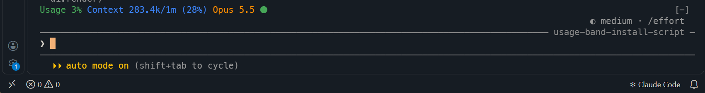
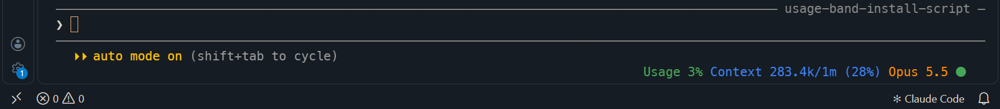
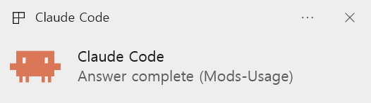

# usage-band

A Claude Code mod that shows your plan usage, context fill, current model and a working/idle indicator next to the prompt — and pops a Windows notification when an answer finishes while you're looking at another app.



## What it shows

| Item | Example | Color |
| --- | --- | --- |
| **Usage** | `Usage 11%` | Green; orange at 80% or more; red at 90% or more |
| **Context** | `Context 45.5k/1m (5%)` — tokens used / context window (percent) | Blue |
| **Model** | `Sonnet 5.5` (from `claude-sonnet-5-5`) | Orange |
| **Status dot** | `⬤` | Red and blinking while Claude is working or answering; steady green when done |

**Usage source**

- **Pro / subscription:** the weekly (`seven_day`) limit.
- **Enterprise:** the `spend_limit` figure.
- If neither is reported, the mod falls back to the monthly credit figure from the usage API (see [How it works](#how-it-works)).
- When no figure is available at all (for example, API-key use), the Usage part is hidden.

## Requirements

- **Claude Code with mod support** (function hooks). This mod was built on Claude Code 2.1.301; the one-line marketplace install needs 2.1.275 or later.
- **Windows** for the completion notification and the Windows installer. The band itself works anywhere; on other systems the notification step simply does nothing.

## Install

Use **only one** install method below — with two, the band appears twice.

### From the marketplace (recommended)

Type this at the Claude Code prompt:

```
/plugin install usage-band --marketplace poucotm/claude-mods-usage-band
```

Answer `y` to add the marketplace, then pick a scope (**user** installs it for all your projects). The band appears in that session right away. Works on any OS.

### With the Windows installer

1. Download `install-usage-band.zip` from the [latest release](https://github.com/poucotm/claude-mods-usage-band/releases/latest) (or `install-usage-band.cmd`, `install-usage-band.ps1` and `claude.ico` from this repository) and **extract all** files into one folder.
   Don't run the `.cmd` from inside the zip viewer — the `.ps1` and `claude.ico` must be next to it.
2. Double-click `install-usage-band.cmd`.
   If Windows shows "Windows protected your PC", choose **More info → Run anyway**.
3. Restart Claude Code.

The installer:

- writes the mod to `%USERPROFILE%\.claude\mods\usage-band\`;
- converts `claude.ico` into the notification logo `claude.png` in that folder (skipped, with a warning, if the icon is missing);
- adds that folder to `env.CLAUDE_CODE_PLUGIN_DIRS` in `%USERPROFILE%\.claude\settings.json`, appending with `;` if other folders are already listed;
- backs up an existing `settings.json` to `settings.json.bak-<timestamp>` first and keeps all your other settings;
- stops without changing anything if `settings.json` isn't valid JSON (for example, a trailing comma).

Running it again updates the mod files and won't add the path twice.

### Manual install

Copy the `usage-band` folder anywhere, then add its absolute path to `~/.claude/settings.json`:

```json
{
  "env": {
    "CLAUDE_CODE_PLUGIN_DIRS": "C:\\Users\\you\\.claude\\mods\\usage-band"
  }
}
```

Use your platform's path-list separator (`;` on Windows, `:` elsewhere) to list several folders.

## Options

Open `/config` in Claude Code and set **Band position**:

| Value | Where the band appears |
| --- | --- |
| `left` (default) | Above the prompt, left-aligned |
| `right` | Above the prompt, right-aligned |
| `below` | On the footer line under the prompt, at the right edge |

**`left`** — the band sits directly above the prompt box:


**`below`** — the band moves to the footer line under the prompt and stays at the right edge, so it doesn't crowd the area above the input:



The setting is stored in `settings.json` under `pluginConfigs`. Changing it in `/config` reloads the mod right away.

## Completion notification

Start a long task, switch to your browser or another app, and get a Windows notification the moment Claude finishes, so you don't have to keep checking back.



- **Header:** a small logo and `Claude Code Notification`, the name of the notifying app.
- **Logo:** the Claude logo on the left.
- **First line:** `Claude Code`.
- **Second line:** `Answer complete (<project folder>)`. The folder name tells you which session finished when several are running.

When an answer finishes, the mod checks which window is in front:

- If it's **VS Code**, **Windows Terminal**, or a **PowerShell / console** window, nothing happens — you're assumed to be watching.
- Otherwise the notification above is shown.

Subagents finishing their own work don't trigger it; only the end of the main answer does.

The toast is sent as an app named **Claude Code Notification**, registered for the current user under `HKCU\Software\Classes\AppUserModelId\ClaudeCode.UsageBand` (created on the first notification). It uses the Windows default notification sound (Control Panel → Sound → *Notification*). The small app icon in the toast's header is drawn by Windows in its own color; the logo in the body keeps its original colors.

**Limitations**

- The check is per program, not per window. While another VS Code or terminal window is in front, no notification is shown.
- If notifications for Claude Code Notification are turned off in Windows Settings, or Do Not Disturb is on, you won't see the toast.

## Update

- **Marketplace:** `claude plugin update usage-band@poucotm-mods`, then restart Claude Code.
- **Windows installer:** download the latest release and run `install-usage-band.cmd` again.

## Uninstall

**Marketplace:**

```
claude plugin uninstall usage-band@poucotm-mods
```

The Windows notification app registration (`HKCU\Software\Classes\AppUserModelId\ClaudeCode.UsageBand`) stays behind; delete that key if you want it gone.

**Windows installer:**

```
install-usage-band.cmd -Uninstall
```

This deletes `%USERPROFILE%\.claude\mods\usage-band\`, removes the Claude Code Notification app registration, and removes only that path from `CLAUDE_CODE_PLUGIN_DIRS`, backing up `settings.json` first. Restart Claude Code afterwards.

## How it works

- **Usage and context** come from figures Claude Code already receives with each API response (`session.measure`, `$.session.usage()`). They update when an answer arrives, not while you're idle.
- **Monthly credits** (only when no weekly or spend-limit figure is reported) are read from `https://api.anthropic.com/api/oauth/usage` using the session's own credential. Requests are made at most every 30 seconds, backing off to 10 minutes on errors. This endpoint isn't part of the documented mod API, so this figure may not match your account page.
- **Model** is read from `$.session.model()` each time the band is drawn, so `/model` changes show immediately.
- **The status dot** follows `turn.start` / `turn.complete` of the main conversation; subagents don't affect it.

## Files

```
install-usage-band.cmd        double-click launcher (runs the .ps1 with ExecutionPolicy Bypass)
install-usage-band.ps1        installer; contains all mod code files
claude.ico                    source of the notification logo (converted to claude.png on install)
usage-band/
  claude.png                  notification logo
  .claude-plugin/plugin.json  manifest and the Band position option
  hooks/hooks.json            points to the hooks module
  hooks/register.tsx          hooks: band drawing, blinking dot, notification
  hooks/format.ts             number, color and model-name formatting
  hooks/format.test.ts        tests (claude plugin test usage-band)
  types/index.d.ts            state type contract
```

## Development

```
claude plugin validate usage-band
claude plugin test usage-band
```

`install-usage-band.ps1` embeds copies of the mod files. After changing anything under `usage-band/`, regenerate the installer so it ships the new version:

```
python tools/gen_installer.py usage-band install-usage-band.ps1
```
